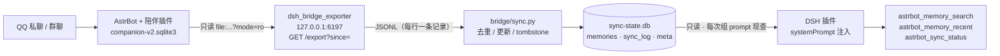

# dsh-astrbot-memory-bridge

> ## ⚠️ 免责声明（请先读）
>
> 1. 本项目是**非官方**的个人项目，与 AstrBot、陪伴插件「我会永远陪着你」的作者、
>    QQ / 腾讯、DeepSeek 均**没有任何隶属或背书关系**。
> 2. 本项目**只读**陪伴插件的数据库，不写入、不改动它的任何数据；也不会写入你的
>    DSH 记忆库（meow-memory）或任何第三方记忆存储。
> 3. 记忆内容属于**个人隐私数据**。导出文件、`sync-state.db` 都含真实的聊天记忆片段，
>    请勿提交到公开仓库、请勿上传到网盘或粘贴进对话；分享问题请先自行脱敏。
> 4. 请遵守你所在平台（QQ / AstrBot 所在服务器）的服务条款与当地法律法规，
>    仅用于**自己的**账号与**自己的**机器人。
> 5. 本项目**不允许**用于批量群发、骚扰他人、账号池运营、自动注册等滥用场景。
> 6. 软件按 MIT 许可「按现状」提供，不附带任何担保；因使用本项目产生的数据丢失、
>    账号风险或其他后果由使用者自行承担。

把 AstrBot 陪伴插件里保存的 QQ 聊天记忆，以**只读**方式单向同步进 DSH，
让 DSH 里的 AI 能自然回忆起「用户以前在 QQ 上和我说过、一起经历过的事」——
不用手动复制粘贴，也不用把记忆写进 DSH 自己的记忆库。

**English summary.** A read-only, one-way bridge that exports memory records from an
AstrBot companion plugin, syncs them incrementally into a local `sync-state.db`, and
lets DSH (DeepSeek Harness) inject a short "recent memories" digest into the system
prompt plus expose three retrieval tools. Nothing is ever written back to the source
database, and no secrets are stored in the repository.

- 版本：**v0.1.0**
- 许可：MIT © 2026 TheCarey
- 运行要求：Node.js ≥ 22.13（需要内置 `node:sqlite`）、Python ≥ 3.10、AstrBot ≥ 4.27.0

---

## 1. 它解决什么问题

陪伴型机器人在 AstrBot 里长期聊天，会积累大量记忆（记忆原子、共同经历、日记、生活事件）。
但 DSH 和 AstrBot 是两套独立的运行时：

- DSH 有自己的记忆系统（meow-memory），和陪伴插件的库互不相通；
- 陪伴插件的库是**插件私有格式**，且明确不建议外部写入（有它自己的治理层与护栏）；
- 手动复制记忆进 DSH 既慢又容易过期。

本项目的做法是：**只读导出 → 增量同步到独立的小库 → DSH 只读消费**。
原库不动，DSH 的记忆库也不动，两边靠一个边界清晰的中间文件（`sync-state.db`）解耦。

## 2. 架构



三条数据通路，任选其一：

| 通路 | 命令 | 适用 |
| --- | --- | --- |
| 文件（离线） | `export_companion.py` → `sync.py --input` | 不想让 AstrBot 开端口 |
| HTTP（推荐） | `sync.py --url http://127.0.0.1:6197/export --token <TOKEN>` | 定时增量同步 |
| 手工 | 把任意符合格式的 JSONL 喂给 `sync.py --input` | 自己写导出器 |

数据格式（每行一条）：

```json
{"id":"a1","kind":"memory","content":"…","occurred_at":"…","updated_at":"…",
 "deleted":false,"role":"companion(10000)","peer":"user(10001)",
 "source":"qq/companion","version":"1","hash":"…"}
```

`kind` 取值：`memory` / `experience` / `diary` / `life_event` / `relationship`。

## 3. 特性

- **只读**：源库用 `mode=ro` 打开，代码里没有任何写陪伴插件库的路径。
- **增量 + 幂等**：按 `hash = sha256(kind|id|updated_at)` 去重，重复同步不产生新行。
- **删除可传播**：源端删除 → 同步库写 `deleted=1`（tombstone），保留行供审计，但不再注入。
- **首轮注入**：最近 N 条（默认 6）记忆以「时间 + 类型 + 来源」标注拼进 system prompt，
  每轮对话现查现拼，改库即生效，不用重启 DSH。
- **三个工具**：关键词检索、最近 N 条、同步状态；检索支持空格分隔多关键词（OR 语义）。
- **静默降级**：库不存在、表缺失、字段变化都不会打断正常对话。
- **不碰别人的数据**：不写 meow-memory，不写 `memory.db`，不改 AstrBot 运行时配置。

## 4. 仓库结构

```
dsh-astrbot-memory-bridge/
├── README.md                     ← 你正在看的这份
├── INSTALL.md                    ← 两侧安装步骤（分步、可照做）
├── CHANGELOG.md
├── LICENSE                       ← MIT
├── NOTICE
├── .gitattributes                ← 统一 LF 换行
├── .gitignore
├── docs/
│   ├── ARCHITECTURE.md           ← 数据流、表结构、DSH 插件 API 契约
│   ├── PRIVACY-AUDIT.md          ← 发布前敏感串扫描流程与结果
│   └── private_companion-schema.md  ← 陪伴插件表结构速查（字段参考，非代码）
├── examples/
│   └── config.example.json       ← 三侧配置示例（占位符，无真实值）
├── dsh-plugin/                   ← DSH 侧 cordis 插件
│   ├── package.json
│   ├── cordis.patch.yml
│   ├── lib/index.js
│   ├── README.md
│   └── tests/test-plugin.mjs
├── astrbot-plugin/
│   └── dsh_bridge_exporter/      ← AstrBot 侧导出插件（127.0.0.1:6197）
│       ├── main.py
│       └── metadata.yaml
└── bridge/                       ← 桥接脚本
    ├── export_companion.py       ← 只读导出器（CLI + 可被插件 import）
    ├── sync.py                   ← 增量同步器（文件 / HTTP）
    └── fixtures/
        ├── companion-export.example.jsonl   ← 纯合成示例数据
        └── run_tests.py                     ← 同步器端到端测试
```

## 5. 快速开始（三步）

> 详细的分步说明、Windows/PowerShell 命令见 [INSTALL.md](INSTALL.md)。
> 下文 `<...>` 全部是占位符，请替换成你自己的路径与令牌。

**第一步：让 AstrBot 开出导出端点**

把 `astrbot-plugin/dsh_bridge_exporter/` 复制进 `<ASTROBOT_HOME>/data/plugins/`，重启 AstrBot，
然后在插件配置里设 `db_root`（指向陪伴插件的数据根）与 `exporter_path`（指向本仓库的
`bridge/export_companion.py`）。验证：

```bash
curl "http://127.0.0.1:6197/health?token=<LOCAL_TOKEN>"
# {"ok": true, "db": "<...>/companion-v2.sqlite3", "port": 6197}
```

**第二步：同步到本地库**

```bash
python bridge/sync.py --url "http://127.0.0.1:6197/export" --token "<LOCAL_TOKEN>"
# {"input": 128, "inserted": 128, ..., "active": 128, "state": ".../sync-state.db"}
```

默认写到 `~/.dsh-bridge/sync-state.db`（Linux/macOS）或
`%USERPROFILE%\.dsh-bridge\sync-state.db`（Windows）。

**第三步：装 DSH 插件**

把 `dsh-plugin/` 复制到 `<DSH_HOME>/plugins/dsh-astrbot-memory-bridge/`，在 DSH profile 里引用
（见 INSTALL.md 第 3 节），重启 DSH。插件页应显示「运行中」，工具列表出现
`astrbot_memory_search` / `astrbot_memory_recent` / `astrbot_sync_status`。

之后再跑一次第二步即可增量更新；想自动化就看 [Roadmap](#9-roadmap)。

## 6. 配置项

### DSH 插件（`apply(ctx, config)`）

| 键 | 环境变量 | 默认 | 说明 |
| --- | --- | --- | --- |
| `dbPath` | `DSH_ASTRBOT_SYNC_DB` | `~/.dsh-bridge/sync-state.db` | 同步库路径（只读） |
| `injectLimit` | — | `6` | 首轮注入条数（0–20，0 = 关注入） |
| `sourceLabel` | — | `来源=QQ 陪伴` | 注入段落里的来源标注行 |
| `timeZone` | — | 系统时区 | 记忆时间戳的展示时区 |

### AstrBot 插件（`dsh_bridge_exporter`）

| 键 | 环境变量 | 默认 | 说明 |
| --- | --- | --- | --- |
| `export_token` | `DSH_BRIDGE_TOKEN` | `local-dev-token` | 访问令牌，**建议改成自己的随机串** |
| `listen_port` | `DSH_BRIDGE_PORT` | `6197` | 监听端口（只绑 `127.0.0.1`） |
| `db_root` | `DSH_BRIDGE_DB_ROOT` | 空 | 陪伴插件数据根，如 `<ASTROBOT_HOME>/data/plugin_data/astrbot_plugin_private_companion` |
| `exporter_path` | `DSH_BRIDGE_EXPORTER` | 自动查找 | `export_companion.py` 的路径或所在目录 |

### 桥接脚本

| 参数 | 环境变量 | 默认 | 说明 |
| --- | --- | --- | --- |
| `--state` | `DSH_SYNC_STATE` | `~/.dsh-bridge/sync-state.db` | 同步库路径 |
| `--input` | `DSH_SYNC_INPUT` | `./export/companion-export.jsonl` | 输入 JSONL |
| `--url` | `DSH_BRIDGE_URL` | 空 | 直接从导出端点拉取 |
| `--token` | `DSH_BRIDGE_TOKEN` | 空 | 导出端点令牌 |
| `--since` | — | 空 | 只同步该 ISO 时间之后更新的记录 |
| `--dry-run` | — | 关 | 只统计、不落库 |
| `--db` / `--root`（export） | `COMPANION_DB` / `COMPANION_DATA_ROOT` | 空 | 定位 `companion-v2.sqlite3` |
| `--role` / `--source`（export） | `DSH_BRIDGE_ROLE` / `DSH_BRIDGE_SOURCE` | `companion` / `qq/companion` | 记录里的角色/来源标注 |

## 7. 安全与隐私

- **不写源库**：`export_companion.py` 用 `sqlite3.connect("file:…?mode=ro", uri=True)`。
- **不写别人的记忆库**：本项目只写 `sync-state.db` 一个文件；meow-memory、`memory.db` 一律不碰。
- **只绑本机**：导出端点固定监听 `127.0.0.1`，不会暴露到局域网/公网；令牌默认值仅为开发方便，
  生产请替换（`export_token` 或 `DSH_BRIDGE_TOKEN`）。
- **数据不出本机**：全过程没有第三方网络请求，只有 `127.0.0.1` 内部 HTTP。
- **仓库里没有隐私数据**：所有路径、QQ 号、昵称、令牌都已替换成占位符；
  `bridge/fixtures/` 里的数据是**纯合成假数据**（`companion(10000)` / `user(10001)`），
  不含任何真实记忆。扫描流程与结果见 [docs/PRIVACY-AUDIT.md](docs/PRIVACY-AUDIT.md)。
- **你的产物也不该进仓库**：`sync-state.db`、`export/*.jsonl`、日志、`.env` 已在 `.gitignore` 中。

## 8. 已知限制

- 记忆正文是从陪伴插件的 `record_json` / `document_json` **启发式提取**的（`content/text/body/summary…`）。
  插件升级若改字段名，需要同步调 `export_companion.py: extract_content`。
- 增量水位目前用 `updated_at`；陪伴插件的 `memory_changes.sequence` 更稳，待真实库验证后可切换。
- 只做了**单向** AstrBot → DSH；DSH → AstrBot 的写回只留了设计与 TODO。
- 只映射了 `memory_atoms` / `relationship_memories` / `role_journals` / `role_activities` /
  `memory_views(kind=experience)` 五类；人物卡、习惯、成长值等派生视图不导出。
- 检索是 `LIKE %关键词%`，不是语义检索；记忆量很大（上万条）时会慢。
- 同步没有后台常驻进程，需要你自己定时触发（见 Roadmap）。

## 9. Roadmap

- [x] v0.1.0：只读导出 + 增量同步 + DSH 三工具 + 首轮注入
- [ ] **自动同步**：内置 `--watch` 轮询（间隔可配，默认 5 分钟），或 Windows 计划任务 / systemd timer 一键安装脚本
- [ ] **双向接口预留落地**：`sync-state.db` 增 `outbox` 表 + 导出器 `POST /import`（带 token），
      写回必须走陪伴插件自带的记忆治理层，不绕过它的去重与护栏
- [ ] 增量水位切换到 `memory_changes.sequence`
- [ ] 检索从 `LIKE` 升级到 FTS5（`node:sqlite` 自带）
- [ ] 人物卡 / 习惯 / 成长值等派生视图的可选导出
- [ ] macOS / Linux 安装脚本与 Docker 示例

## 10. 开发与测试

```bash
# DSH 插件逻辑测试（自动建合成库，无需 DSH 运行时）
node dsh-plugin/tests/test-plugin.mjs

# 同步器端到端测试（导出→同步→去重/更新/tombstone，纯合成数据）
python bridge/fixtures/run_tests.py
```

期望输出：`PLUGIN TEST OK` 与 `SYNC TEST OK`（含 `[ok]` 四步计数）。

## 11. 许可与致谢

- 本项目代码：MIT License，© 2026 **TheCarey**，见 [LICENSE](LICENSE)。
- 本项目**不含**任何第三方代码副本；AstrBot 与陪伴插件只通过进程边界（只读数据库、HTTP）交互，
  相关名称仅用于说明兼容性，版权归各自作者所有，详见 [NOTICE](NOTICE)。
- 灵感来自「AI 不该忘记和你说过的话」这件小事。