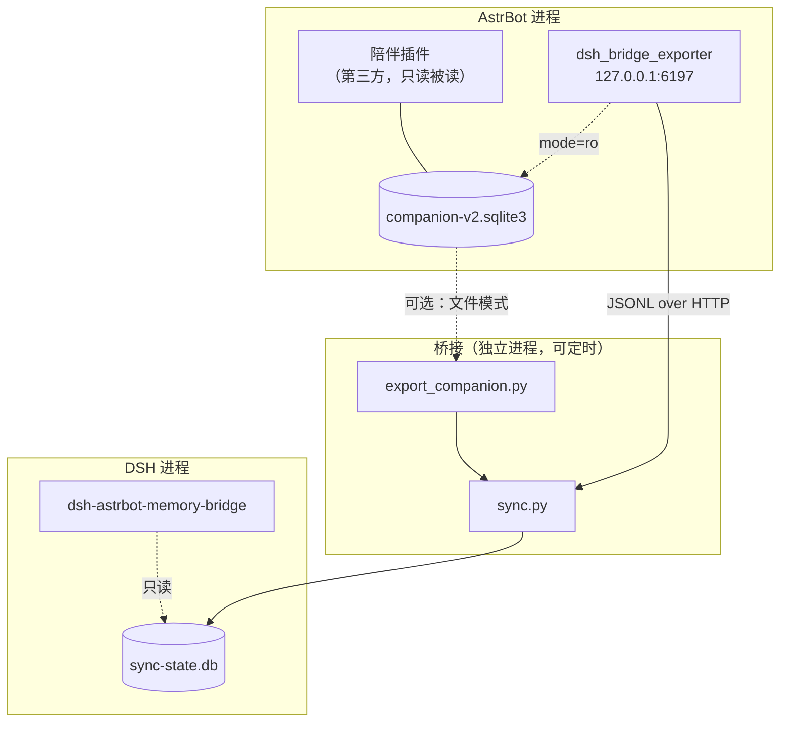

# 架构说明

本文描述三块代码之间的数据流、同步库结构，以及两个容易被踩的运行时契约。

## 1. 组件与边界



三个进程之间只有两种耦合：

1. **只读 SQLite 文件**（AstrBot 侧读陪伴库；DSH 侧读同步库）
2. **本机 HTTP**（`127.0.0.1`，JSONL over HTTP）

没有任何一方 import 另一方的代码，也没有共享内存或全局状态。

## 2. 源库（陪伴插件）字段映射

导出器只认「表存在 + 有主键」的宽松约定，字段名按优先级探测，插件升级不至于立刻崩。

| 目标 `kind` | 源表 | 主键 | 说明 |
| --- | --- | --- | --- |
| `memory` | `memory_atoms` | `atom_id` | 记忆原子；`state` 非 active 视为删除 |
| `experience` | `relationship_memories` | `id` | 共同经历/关系记忆 |
| `diary` | `role_journals` | `id` | 日记 |
| `life_event` | `role_activities` | `id` | 生活事件 |
| `experience` | `memory_views`（`kind='experience'`） | `view_id` | 7.x 起的经历视图，正文在 `document_json.statements[].text` |

正文不是独立的文本列，需要从 `record_json` / `document_json` 里启发式提取
（`content` → `text` → `body` → `summary` → `value` → …，见 `extract_content`）。

时间水位：`updated_at` → `modified_at` → `created_at`（取第一个存在的列）。
删除判定：`state ∈ {deleted, removed, archived, revoked, tombstone}`。

## 3. 同步库 `sync-state.db`

```sql
CREATE TABLE memories (
    id TEXT PRIMARY KEY,        -- 源主键（视图记录加 "view:" 前缀）
    kind TEXT NOT NULL,         -- memory/experience/diary/life_event/relationship
    content TEXT NOT NULL,      -- 正文（已裁掉首尾空白）
    occurred_at TEXT, updated_at TEXT,
    deleted INTEGER DEFAULT 0,  -- 1 = tombstone，保留行但不再注入
    role TEXT, peer TEXT, source TEXT, version TEXT,
    hash TEXT NOT NULL,         -- sha256(kind|id|updated_at)[:32]
    first_seen TEXT NOT NULL, last_sync TEXT NOT NULL
);

CREATE TABLE sync_log (       -- 每次运行追加一行，便于审计
    seq INTEGER PRIMARY KEY AUTOINCREMENT,
    at TEXT, source TEXT,
    inserted INTEGER, updated INTEGER, deleted INTEGER,
    skipped INTEGER, errors INTEGER, note TEXT
);

CREATE TABLE meta (key TEXT PRIMARY KEY, value TEXT);
-- last_sync / last_input
```

### 去重、更新、删除传播

| 情形 | 判定 | 动作 | 计数 |
| --- | --- | --- | --- |
| 没见过的新记录 | `id` 不存在 | `INSERT` | `inserted` |
| 完全相同 | `hash` 与 `deleted` 都没变 | 只刷 `last_sync` | `skipped` |
| 内容变了 | `id` 在、`hash` 变 | `UPDATE` | `updated` |
| 源端删了 | `deleted=true` 且行已存在 | `UPDATE deleted=1` | `deleted` |
| 没见过就被删 | `deleted=true` 但行不存在 | 跳过（不制造幽灵行） | `skipped` |

`hash` 里带 `kind|id|updated_at`，所以「同一秒内两次写入」会被视为同版本——这在陪伴插件里
是可接受的（它的修订号也会变一个 `revision`，而 `revision` 已在导出时进 `version` 字段）。

## 4. DSH 插件契约（v0.1.0 踩过的坑）

DSH 的 cordis 扩展点对参数形状要求很严，而失败常常被 `try/catch` 吞掉，表现为「装了、显示运行中、
但完全没有效果」。正确写法：

### 4.1 注入：`variable` + `context`

```js
ctx.systemPrompt.variable('astrbot_companion', () => buildText())   // 每轮组 prompt 时求值
ctx.systemPrompt.context({
  name: 'astrbot-memory-bridge:companion',   // 必须给 name
  order: 205,                                 // 必须是有限数字
  text: '{{astrbot_companion}}',              // 必须是字符串；函数会被拒绝/静默失效
})
```

要点：

- `context.text` **不能是函数**。想要动态内容，必须用 `{{变量名}}` 引用 `variable` 注册的求值函数。
- `order` 是有序插入位置，给 `undefined`/`NaN` 会被拒。本项目取 205（排在多数内置上下文之后）。
- 求值函数每轮都会被调用，所以库变了立刻生效，不需要重启 DSH；库不存在时返回空串，段落自然消失。

### 4.2 工具：`output: { schema, render }`

```js
ctx.tools.register({
  name, description, parameters,          // parameters 是 JSON Schema
  output: {
    schema: { /* 返回值形状；additionalProperties:false 更安全 */ },
    render: (_args, value) => [{ type: 'text', text: '…' }],
  },
  async execute(args) { return value }    // 返回「值」，不要返回内容块数组
})
```

要点：

- 缺 `output` 时注册可能「成功」但调用即失败。
- `execute` 的返回值必须符合 `output.schema`，否则渲染阶段报错。
- `render` 负责把值变成内容块；纯文本用 `[{type:'text', text}]`。

### 4.3 注入文本的形状

```
【来自 QQ 陪伴的近期记忆】
来源=QQ 陪伴
1. [共同经历｜2026-01-15 09:00] …
2. [生活｜2026-01-14 09:00] …
…（默认 6 条，每条截断 120 字）
（这些是和用户在 QQ 上聊过/一起经历过的事；需要更早或更细的内容时用 astrbot_memory_search 检索。）
```

设计考虑：

- 标题与来源行让模型知道「这是外部记忆，不是当前对话内容」，降低幻觉式引用。
- 时间统一换算到配置时区（默认系统时区），避免模型把 UTC 当本地时间。
- 单条截断 120 字，防注入段落吃掉上下文预算；完整内容靠工具按需检索。
- 结尾一句引导，告诉模型「还有更早的记忆，可以查」，提高工具命中率。

## 5. 失败模式与降级

| 环节 | 失败表现 | 设计上的处理 |
| --- | --- | --- |
| 源库不存在 | `/health` 的 `db` 为 null；`/export` 返回 404 | 导出器正常启动，不阻塞 AstrBot |
| 表结构变了 | 导出器打 `[warn] <table>: …`，跳过该表 | 其余表照常导出 |
| 端口被占用 | warning「沿用已在监听的实例」 | 不重复绑端口、不崩溃 |
| 同步库不存在 | 插件 `query()` 返回 `[]` | 注入为空，工具返回「还没有记忆」 |
| 表缺失/损坏 | `DatabaseSync` 抛错被吞 | 静默降级，不打断对话 |
| 网络拉了空body | `input=0` | 不改库，只写一条 `sync_log` |

## 6. 安全边界

- 导出器**只**打开 `file:…?mode=ro`，代码里没有 `INSERT/UPDATE/DELETE` 针对源库。
- 同步器**只**写 `sync-state.db`，路径由 `--state` 决定。
- DSH 插件**只**用 `{ readOnly: true }` 打开同步库。
- 导出端点只绑 `127.0.0.1`，令牌校验在路由层（`/health` 与 `/export` 都要）。
- 仓库内不含任何真实记忆；`fixtures` 全是合成数据。

## 7. 后续演进方向

1. **自动同步**：`sync.py --watch <间隔>` 或系统定时任务；水位从 `updated_at` 换成 `memory_changes.sequence`。
2. **双向预留**：`outbox` 表 + 导出器 `POST /import`；写回必须走陪伴插件自己的治理层
   （`memory_operations` + 护栏），不能直写它的表——直写会被它下一轮治理判为异常或覆盖。
3. **检索增强**：`node:sqlite` 自带 FTS5，可把 `LIKE` 换成 FTS5 + bm25 排序。